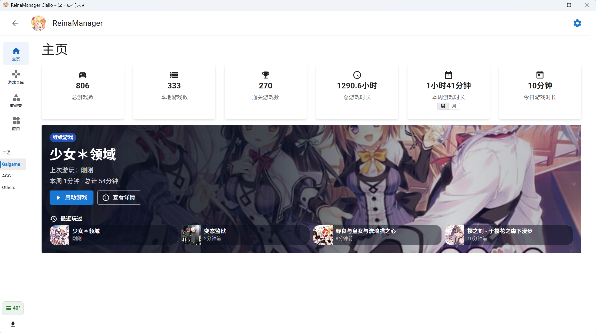
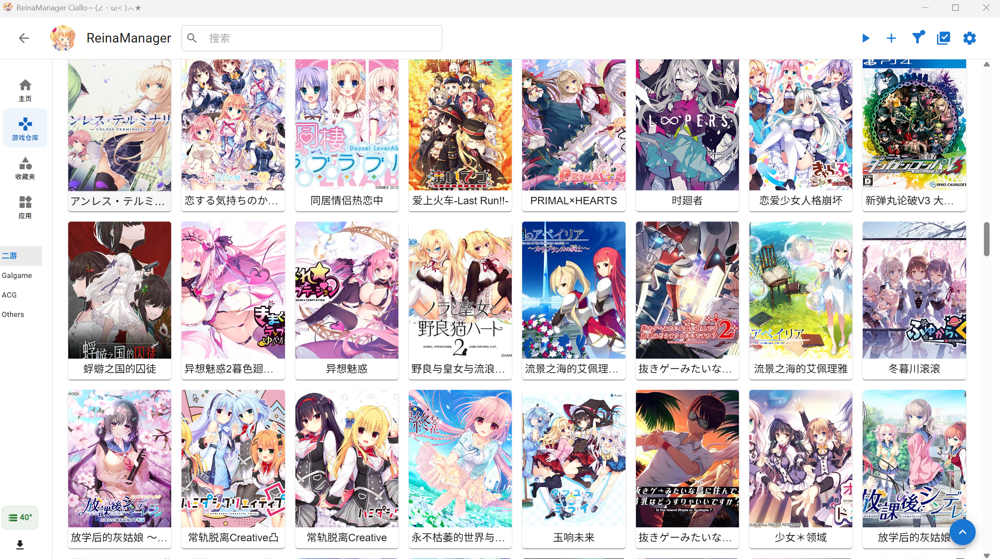
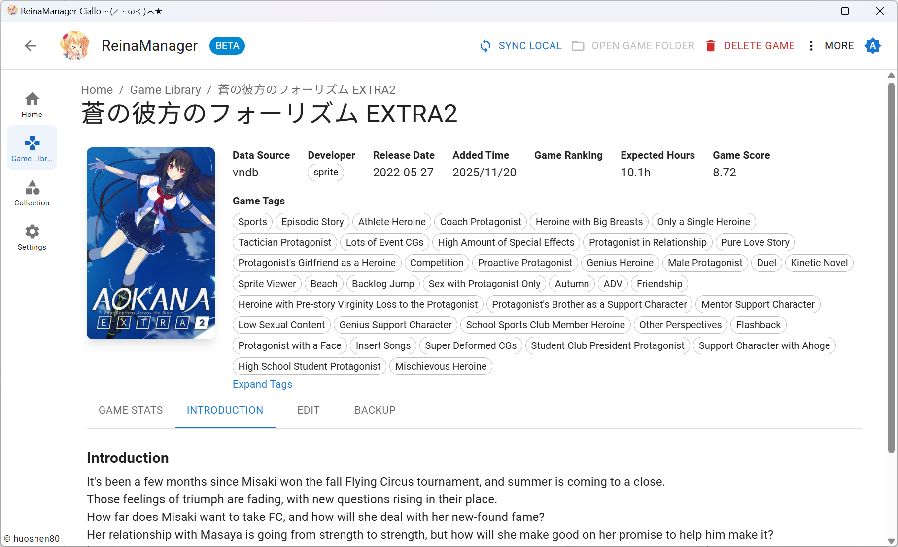
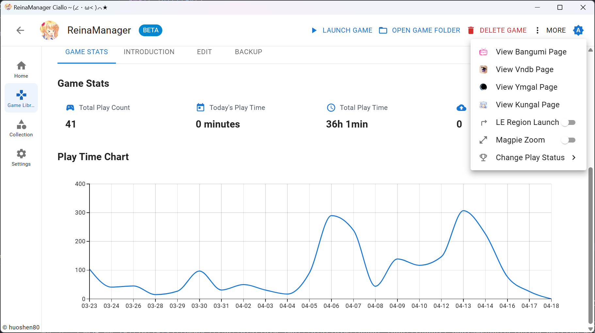
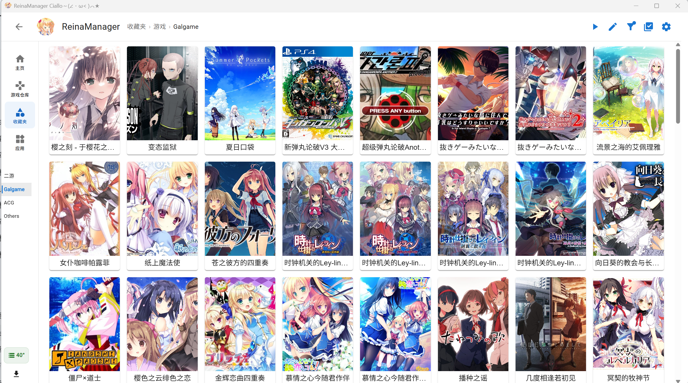

<div align="center">
  <div style="width:200px">
    <a href="https://vndb.org/c64303">
      
    </a>
  </div>

<h1>ReinaManager — Customized Edition</h1>

<p align="center"><a href="./README.md">English</a>|<a href="./README.zh_CN.md">中文</a>|<a href="./README.zh_TW.md">繁體中文</a>|日本語</p>

<h5>軽量なギャルゲー・ビジュアルノベル管理ツール、開発中...</h5>

名前の `Reina` は、ゲーム <a href="https://vndb.org/v21852"><b>金色ラブリッチェ(Kin'iro Loveriche)</b></a> のキャラクター <a href="https://vndb.org/c64303"><b>妃 玲奈(Kisaki Reina)</b></a> に由来しています

</div>

> [!IMPORTANT]
> これは [huoshen80/ReinaManager](https://github.com/huoshen80/ReinaManager) を基にしたコミュニティ保守版です。独自のアプリ識別子と配布ページを使用し、上流の自動更新には追従しません。この改版に関する問題は、このリポジトリで報告してください。

> [!NOTE]
> この改版は上流の AGPL-3.0 ライセンスと著作権表示を維持します。詳細は [LICENSE](./LICENSE) と [NOTICE.md](./NOTICE.md) を参照してください。一部の変更と文書には AI ツールを利用し、コミット前に人手で整理・検証しています。

## この改版の主な変更点

- 0.20.4 にあるメタデータ検索、コレクション、プレイ記録、セーブデータ、基本的な一括操作を維持しつつ、ローカルゲームライブラリの整理・移行・保守を強化しています。
- 複数の既定スキャンルート、深い階層の起動ファイル検索、ドライブ文字をまたぐパス重複判定、Bangumi／DLsite の手動ソース選択、フォルダーを直接開ける一括インポートを追加しています。
- ソースフォルダーによる自動分類、アプリのショートカット取り込み、データベース／カスタムカバーのバックアップと復元、キュー・検証・ごみ箱・ディレクトリ保護を備えたダウンロードとゲームアーカイブを提供します。
- 上流の後続版から適切な互換性改善を選択的に取り込むことがありますが、それらをこの改版独自の機能としては紹介しません。

## Stacks

- Tauri 2.0

- React

- Material UI

- UnoCSS

- Zustand

- TanStack Query

- Sqlite

- Rust

- SeaORM

## 機能

- 🌐 **マルチソースデータ統合** - VNDB、Bangumi、YmGal、Kungal API からゲームメタデータをシームレスに取得・統合
- 🔍 **強力な検索** - ゲームタイトル、エイリアス、カスタム名、その他のメタデータを通じてゲームをスマート検索
- 📚 **コレクション管理** - 階層的な分類とカテゴリを使用してゲームを整理し、ゲームライブラリをより効果的に管理、ドラッグ＆ドロップによる並び替えをサポート
- 🎮 **プレイ時間追跡** - ゲームセッションを自動記録し、詳細なプレイ時間統計と履歴を提供
- 🎨 **パーソナライズ** - ゲームにカスタムメタデータ（カバー、名前、タグなど）を設定し、パーソナライズされたゲームライブラリを構築
- 🔄 **バッチ操作** - API からゲームメタデータを一括でインポート・追加・更新
- 🌍 **多言語サポート** - 完全な国際化サポートで、中国語（簡体字、繁体字）、英語、日本語など、複数の言語インターフェースを提供
- 🔒 **NSFW フィルター** - 簡単なスイッチでNSFWコンテンツを非表示またはカバー
- 💾 **自動セーブバックアップ** - 設定可能な自動バックアップ機能で、ゲームセーブデータを保護
- 🚀 **システム統合** - 起動時の自動起動とシステムトレイへの最小化
- 🎮 **ツール統合** - ゲーム起動時に LE ロケール切り替えと Magpie 拡大を連動

## やることリスト（Todo）

- [x] フォルダからゲームを一括インポート
- [x] Linux プラットフォームの基本サポート
- [x] Bangumi と VNDB でゲームステータスを同期
- [ ] 各ページの美化

## 移住する

他のギャルゲー・ビジュアルノベル管理ツールからデータを移行する必要がありますか？[reina_migrator](https://github.com/huoshen80/reina_migrator) をご覧ください - 他の管理ツールのデータを ReinaManager に移行するためのツールです。

現在サポート：
- **WhiteCloud** データ移行

この移行ツールは、ゲームライブラリ、プレイ時間記録、その他のデータをサポートされている管理ツールから ReinaManager にシームレスに転送するのに役立ちます。

## スクリーンショット







この改版は上流の自動更新を使用しません。公開ビルドは `pnpm run package:public` で作成し、独自の署名鍵と更新先を用意するまでは手動配布のみを行ってください。

## コントリビュート
##### まず
貢献は大歓迎です！改善提案、バグ報告、プルリクエストの送信は以下の手順に従ってください：

1. このリポジトリをフォークし、`main` ブランチから新しいブランチを作成します。
2. バグ修正や機能追加を行った場合は、適切なテストを追加してください。
3. コードスタイルを既存のプロジェクトに合わせ、すべてのチェックを通過させてください。
4. 変更内容を明確に説明したプルリクエストを作成してください。

##### プロジェクトをローカルでビルド・実行する方法
1. [Node.js](https://nodejs.org/) と [Rust](https://www.rust-lang.org/) をインストールします。
2. リポジトリをクローン：
   ```bash
   git clone https://github.com/AnneLuckyyy/ReinaManager-Custom.git
   cd ReinaManager-Custom
   ```
3. 依存関係をインストール：
   ```bash
   pnpm install
   ```
4. 開発サーバーを起動：
   ```bash
   pnpm tauri dev
   ```
5. 本番向けビルド：
   ```bash
   pnpm run package:public
   ```

この改版への貢献に感謝します。上流プロジェクトの著作権表示と AGPL-3.0 の義務を維持してください。

## 支援する
もしこのプロジェクトが役立つと感じ、継続的な開発を支援したい場合は、ご支援を検討いただければ幸いです。皆様の応援が大きな励みになります！

## データソース

- **[Bangumi](https://bangumi.tv/)** - Bangumi 番組計画

- **[VNDB](https://vndb.org/)** - the visual novel database

- **[Ymgal](https://www.ymgal.games/)** - 月幕Galgame

- **[Kungal](https://www.kungal.com/)** - 鲲 Galgame

これらのプラットフォームが提供するパブリック API とデータに感謝します！

## ライセンス

本プロジェクトは [AGPL-3.0 ライセンス](./LICENSE) の下で公開されています。

## Star履歴
