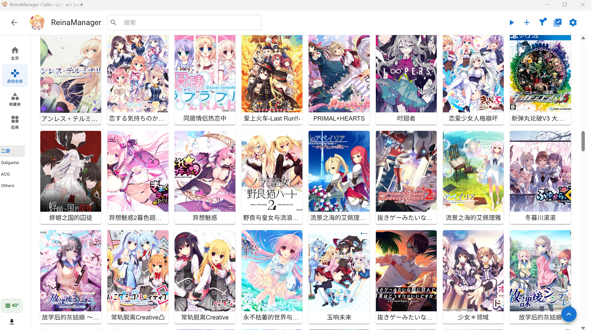
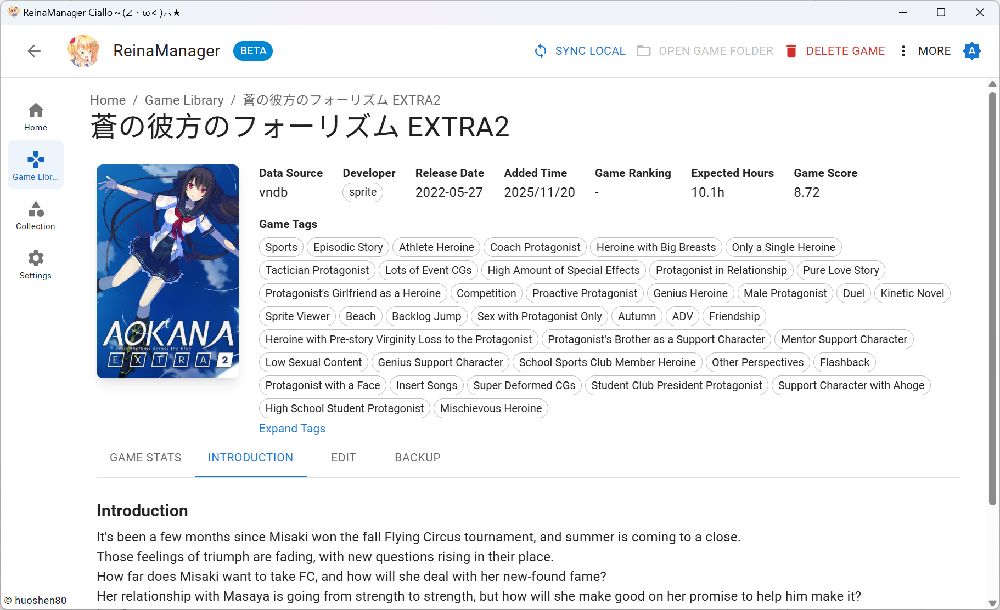
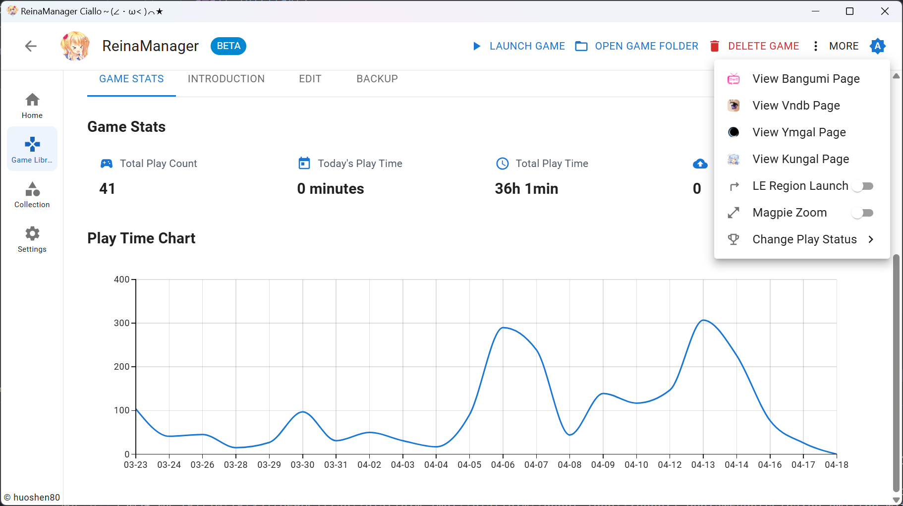
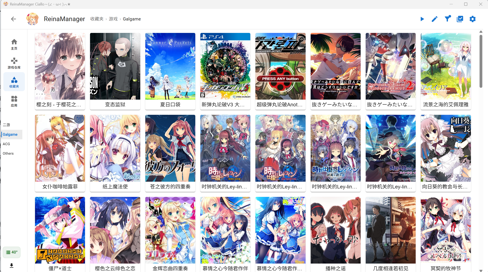

<div align="center">
  <div style="width:200px">
    <a href="https://vndb.org/c64303">
      
    </a>
  </div>

<h1>ReinaManager — 改版扩展</h1>

<p align="center"><a href="./README.md">English</a>|中文|<a href="./README.zh_TW.md">繁體中文</a>|<a href="./README.ja_JP.md">日本語</a></p>

<h5>一个轻量级的galgame/视觉小说管理工具，正在开发中...</h5>

名称中的 `Reina` 来源于游戏 <a href="https://vndb.org/v21852"><b>金色ラブリッチェ(Kin'iro Loveriche)</b></a> 中的角色 <a href="https://vndb.org/c64303"><b>妃 玲奈(Kisaki Reina)</b></a>

</div>

> [!IMPORTANT]
> 这是基于 [huoshen80/ReinaManager](https://github.com/huoshen80/ReinaManager) 的社区维护改版。它使用独立的应用标识和发布页，不跟随上游的自动更新；遇到本改版相关的问题，欢迎在本仓库反馈。

改版仓库：[AnneLuckyyy/ReinaManager-Custom](https://github.com/AnneLuckyyy/ReinaManager-Custom)。

> [!NOTE]
> 本改版保留上游的 AGPL-3.0 许可证与版权声明，详见 [LICENSE](./LICENSE) 和 [NOTICE.md](./NOTICE.md)。部分改动与文档借助 AI 工具完成，并在提交前进行人工整理与验证。

## 改版要点

- 在保留 0.20.4 原有资料检索、收藏夹、计时、存档与基础批量操作的基础上，本改版重点补强本地游戏库的整理、迁移与维护体验。
- **本地导入与资料匹配**：支持多个默认扫描根目录、深层启动程序扫描、跨盘符路径去重、手动切换 Bangumi／DLsite 等资料来源；可在导入列表中直接打开对应文件夹核对结果，并保留未列入项目及其原因。
- **路径、启动与云端状态**：主路径和备用路径会保留历史；启动失败时可按设置尝试更换盘符；右键即可把本地游戏设为云端游戏，并为打开游戏目录提供上级目录回退。
- **自动归类与应用管理**：可把多个本地来源目录绑定到收藏夹分类；单个导入、批量导入、下载/安装入库会自动追加相应分类。应用页支持拖入 `.lnk`、`.url`、`.exe`，也可按来源目录手动扫描整理应用快捷方式。
- **备份、恢复与封面**：数据库备份和恢复覆盖设置及应用页数据；自定义封面可单独备份和恢复，不会混入网络封面缓存。支持月度及退出时自动备份。
- **下载与游戏归档**：下载任务可在可靠匹配后自动入库、清理任务文件并接续后续任务；游戏可通过 7-Zip 排队打包、核验内容，再按设置移入回收站或删除原目录。涉及删除时始终需要明确选择，并默认保护每个盘符 `Games` 目录下的直属文件夹。
- **更易管理的设置**：设置按功能分区并提供路径/目录关联的二级页面；普通问号给出短说明，复杂选项可打开更完整的使用场景、步骤与安全边界。新安装不会预填个人目录或外部工具路径。

本仓库也会选择性合入上游后续版本中适合本改版的兼容性改进；这类内容不作为本改版的独创功能宣传，具体差异会在变更记录中说明。

## 使用与贡献

- 当前以 Windows 为主要开发和验证环境；其它平台的基础能力可能可用，但不承诺所有扩展工作流一致。
- 欢迎提交问题和改进建议。提交代码前请确认不包含本地数据库、封面归档、Token、下载文件、安装包或私钥；`.gitignore` 只是基础保护，仍建议先检查 `git status`。
- 本改版与上游会分别演进。体验测试构建或手动安装新版本前，建议先备份自己的数据库。

## 技术栈

- Tauri 2.0

- React

- Material UI

- UnoCSS

- Zustand

- TanStack Query

- Sqlite

- Rust

- SeaORM

## 功能特性

- 🌐 **多源数据整合** - 无缝获取并合并来自 VNDB、Bangumi、YmGal 和 Kungal API 的游戏元数据
- 🔍 **强大的搜索** - 通过游戏标题、别名、自定义名称及其他元数据智能搜索游戏
- 📚 **收藏管理** - 使用分层的分组和分类来组织游戏，更好地管理游戏库，支持拖拽排序
- 🎮 **游戏时长追踪** - 自动记录游戏会话，提供详细的游玩时间统计和历史记录
- 🎨 **个性化定制** - 为游戏设置自定义元数据，如封面、名称、标签等，打造个性化游戏库
- 🔄 **批量操作** - 从 API 批量导入、添加和更新游戏元数据
- 🌍 **多语言支持** - 完整的国际化支持，提供多种语言界面，包括中文(简体、繁体)、英文、日文等
- 🔒 **NSFW 过滤** - 通过简单的开关隐藏或遮盖 NSFW 内容
- 💾 **自动存档备份** - 可配置的自动备份功能，保护您的游戏存档数据
- 🚀 **系统集成** - 开机自启动和最小化到系统托盘
- 🎮 **工具集成** - 启动游戏可联动 LE 转区和 Magpie 放大

## 待办事项

- [x] 从文件夹批量导入游戏
- [x] 对 Linux 平台的基础支持 
- [x] 与 Bangumi 和 VNDB 同步游戏状态
- [ ] 美化各个页面

## 迁移

需要从其他 galgame/视觉小说管理器迁移数据？请查看 [reina_migrator](https://github.com/huoshen80/reina_migrator) - 一个用于将其他管理器数据迁移到 ReinaManager 的工具。

当前支持：
- **WhiteCloud** 数据迁移

该迁移工具可帮助您无缝转移游戏库、游玩时间记录和其他数据到 ReinaManager。

## 截图







## 发布说明

本改版已有独立应用标识，且不会使用上游的发布通道或自动更新。公开构建请使用 `pnpm run package:public`，生成的安装包可作为手动下载的 Release 附件发布。在本仓库具备自己的签名密钥和更新地址前，不要开启应用内自动更新；自动发布工作流也暂时保持关闭。

## 贡献
##### 开始
欢迎任何形式的贡献！如果你有改进建议、发现了 bug，或希望提交 Pull Request，请按照以下步骤操作：

1. Fork 本仓库，并从 `main` 分支创建新分支。
2. 如果修复了 bug 或新增了功能，请尽量进行相应测试。
3. 保证代码风格与现有代码一致，并通过所有检查。
4. 提交 Pull Request，并清晰描述你的更改内容。

##### 本地构建与运行项目
1. 确保你已安装 [Node.js](https://nodejs.org/) 和 [Rust](https://www.rust-lang.org/)。
2. 克隆仓库：
   ```bash
   git clone https://github.com/AnneLuckyyy/ReinaManager-Custom.git
   cd ReinaManager-Custom
   ```
3. 安装依赖：
   ```bash
   pnpm install
   ```
4. 运行开发服务器：
   ```bash
   pnpm tauri dev
   ```
5. 构建生产版本：
   ```bash
   pnpm run package:public
   ```

感谢你为本改版做出的贡献。请始终保留原项目署名与 AGPL-3.0 义务。

## 数据源

- **[Bangumi](https://bangumi.tv/)** - Bangumi 番组计划

- **[VNDB](https://vndb.org/)** - 视觉小说数据库

- **[Ymgal](https://www.ymgal.games/)** - 月幕Galgame

- **[Kungal](https://www.kungal.com/)** - 鲲 Galgame

特别感谢这些平台提供的公共 API 和数据！

## 许可证

本项目采用 [AGPL-3.0 许可证](./LICENSE)，原项目来源与改动说明见 [NOTICE.md](./NOTICE.md)。
